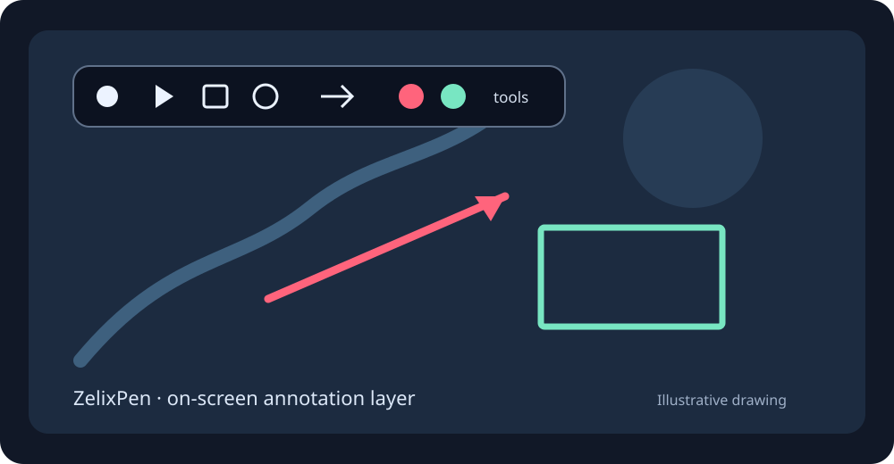

# ZelixPen

ZelixPen is a lightweight on-screen drawing and annotation tool for ZelixOS. A frameless, transparent overlay lets you mark up the visible desktop; a separate floating toolbar stays available when you switch to pointer mode.



English, Turkish, and Spanish are available in the toolbar language selector. The selection is saved for the current user.

## Features

- Freehand pen, line, arrow, rectangle, circle, and eraser tools.
- Adjustable drawing color and line width.
- Pointer mode to interact with applications beneath the overlay, then return to drawing with a tool selection.
- Undo and redo, clear all marks, and save the current drawing as a transparent PNG.
- Keyboard shortcuts: `Ctrl+Z` undo, `Ctrl+Shift+Z` redo, and `Esc` exit.

## Install

On ZelixOS with ZelixRepo enabled:

```bash
sudo pacman -Syu zelixpen
```

Launch from the application menu or run:

```bash
zelixpen
```

## Quick start

1. Launch ZelixPen. The overlay covers the primary display and the toolbar appears near its upper-left corner.
2. Select **Pen**, **Line**, **Arrow**, **Rectangle**, **Circle**, or **Eraser** and draw with the mouse.
3. Choose a color and adjust the width slider to change subsequent marks.
4. Use **Undo** or **Redo** to revise the drawing. **Clear** asks before removing all marks.
5. Choose **Save** to export a transparent PNG; choose a destination in the file dialog.
6. Select **Pointer** to hide the drawing layer and interact with the desktop. Choose a drawing tool to return to annotation mode.
7. Press `Esc` or the close button to exit.

The toolbar can be dragged to another position. Pointer behavior and window stacking can vary by desktop compositor; the application is designed for ZelixOS desktop sessions, including KDE Plasma.

## Run from source

Install Python and PyQt6 on an Arch-based desktop, then run:

```bash
git clone https://github.com/ZelixOS/zelixpen.git
cd zelixpen
python main.py
```

The current screen overlay uses the primary display geometry. If you use multiple monitors, test which display is selected by your desktop session before relying on it for a presentation.

## Troubleshooting

- **The overlay does not accept drawing input:** exit pointer mode by selecting a drawing tool; check whether another always-on-top window is covering the toolbar.
- **Clicks do not reach the application below:** switch to Pointer mode. Compositor and desktop behavior can affect input passthrough.
- **PNG export fails:** choose a writable destination and confirm there is sufficient free space.
- **The toolbar is off-screen:** restart the app to restore its default toolbar position.
- **Language is not what you expect:** select a language in the toolbar; the choice is saved for the user.

The package recipe is maintained in [ZelixRepo](https://github.com/ZelixOS/zelix-repo/tree/main/zelixpen). Include the desktop session, display setup, ZelixPen version, and steps to reproduce when reporting a problem.
